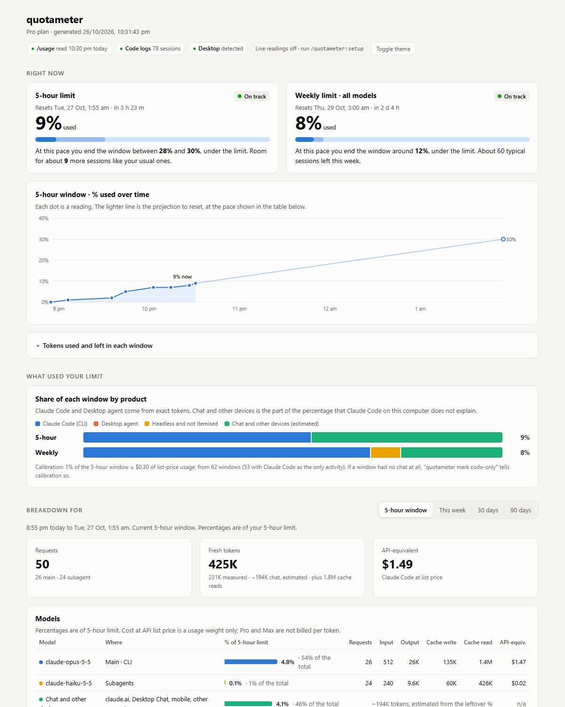

# quotameter

[](https://github.com/pandiankaruppaiah/quotameter/actions/workflows/test.yml)


See where your Claude Pro or Max quota goes: Claude Code, Claude Desktop and claude.ai, in one local report.

Anthropic shows you two percentages, the 5-hour window and the week. quotameter answers the questions behind them: will I hit the limit before it resets, how many more sessions fit, and what used it (which product, model, subagent, project, session, skill, tool and MCP server, with chat estimated). It warns you in Claude Code before a limit hits, and everything stays on your computer.



*Screenshot from synthetic demo data (`node scripts/demo.js`). Open [docs/sample-report.html](docs/sample-report.html) for the full page.*

## Contents

- [Requirements](#requirements)
- [Install](#install) on Windows, macOS and Linux
- [What the report shows](#what-the-report-shows)
- [How it works](#how-it-works)
- [History and retention](#history-and-retention)
- [Privacy](#privacy)
- [Commands and settings](#commands-and-settings)
- [Troubleshooting](#troubleshooting)
- [Limits](#limits) and [roadmap](#roadmap)

## Requirements

- A Claude Pro or Max plan. API-key accounts have no plan limits; the token breakdowns still work.
- [Claude Code](https://docs.claude.com/en/docs/claude-code) 2.1 or newer, signed in.
- Node.js 18 or newer on your `PATH`. Claude Code's native installer does not include Node, so check with `node --version`.

| System | Install Node |
|---|---|
| Windows 10 and 11 | `winget install OpenJS.NodeJS.LTS`, or the installer from [nodejs.org](https://nodejs.org) |
| macOS | `brew install node`, or the installer from [nodejs.org](https://nodejs.org) |
| Linux | Your package manager (`sudo apt install nodejs`, `sudo dnf install nodejs`), or [nvm](https://github.com/nvm-sh/nvm) |

Claude Desktop is optional. With it, quotameter also reads Desktop's usage history and can tell Desktop agent sessions apart.

## Install

### As a Claude Code plugin (recommended)

The same steps work on Windows, macOS and Linux. Inside Claude Code:

```
/plugin marketplace add pandiankaruppaiah/quotameter
/plugin install quotameter@quotameter
```

Or from a terminal:

```
claude plugin marketplace add pandiankaruppaiah/quotameter
claude plugin install quotameter@quotameter
```

Restart Claude Code, then:

```
/quotameter:setup
/quotameter:status
```

`/quotameter:setup` adds a status line that shows `5h 17% (resets 5:39pm) | wk 3%` and records a reading every minute while you work. It shows you the change to `~/.claude/settings.json` first, keeps a backup, and keeps your existing status line if you have one. Do this step: every estimate in the report is built from these readings.

`/quotameter:status` answers in the terminal: both limits, where your pace ends up, sessions left. `/quotameter:report` opens the full report. The plugin's hooks record usage at the start and end of each session and take a free `/usage` reading every ten minutes while you work, and they warn you once when a limit passes 80% and again at 95%.

To check what quotameter can see on your computer, run `npx github:pandiankaruppaiah/quotameter doctor` in a terminal. It also says whether the status line is set up.

### Without the plugin

Run the report straight from GitHub, no install:

```
npx github:pandiankaruppaiah/quotameter
```

Or from a clone:

```
git clone https://github.com/pandiankaruppaiah/quotameter
cd quotameter
node plugins/quotameter/bin/quotameter.js report
```

Without the plugin's hooks, quotameter only reads data when you run it. Claude Code's logs keep the token history, but limit percentages are only recorded at those moments.

### Where things live

| | Windows | macOS | Linux |
|---|---|---|---|
| quotameter data | `%USERPROFILE%\.quotameter` | `~/.quotameter` | `~/.quotameter` |
| Claude Code logs | `%USERPROFILE%\.claude\projects` | `~/.claude/projects` | `~/.claude/projects` |
| Claude Desktop data | `%APPDATA%\Claude`, or the Microsoft Store app's folder | `~/Library/Application Support/Claude` | `~/.config/Claude` |

`QUOTAMETER_HOME` moves quotameter's data. `CLAUDE_CONFIG_DIR` is honoured if you use it for Claude Code.

### Update and uninstall

In Claude Code:

```
/plugin marketplace update quotameter
/plugin update quotameter@quotameter
/plugin uninstall quotameter@quotameter
```

Or from a terminal, the same commands with `claude plugin` in place of `/plugin`.

If you ran `/quotameter:setup`, run `/quotameter:setup remove` first (or `quotameter setup --remove` in a terminal); it restores the status line you had before. Delete `~/.quotameter` to remove all collected data.

## What the report shows

**Right now.** Both limits as meters with one plain sentence each: how much is used, when it resets, where your current pace ends up (as a range when your recent pace and the window average disagree), and how many more sessions like your usual ones fit. Tokens are quoted as fresh tokens (input, output, cache writes); cache reads are listed but never extrapolated, so a new session is not promised tokens it does not have.

**What used your limit.** Each window split into Claude Code, Desktop agent sessions, headless runs and estimated chat. Then a breakdown for the 5-hour window, this week, 30 days or 90 days: models (main conversation and subagents), projects and branches, your most expensive sessions, subagents, skills, tools, MCP servers and plugins.

**Make it last longer.** Recommendations from your own data, what this week's Opus work would have cost on Sonnet or Haiku, your plan's API-equivalent value, and a verdict on whether your plan fits.

**Your patterns.** What a typical session costs, which limit actually stops you, allowance that reset unused, burn rate while working, when you hit the limit, this week against last week, the last 12 weeks (as % of limit, tokens, or tokens with cache reads), and Claude Code and chat by day.

**Technical details** (collapsed). Prompt cache hit rate and the cost of rebuilding it after pauses, subagent overhead, context growth per turn, session length, and when in the week you use Claude Code.

With no limit readings yet, the report says so in one card, explains what already works and what needs readings, and hides the parts that would only show "n/a".

Ask `/quotameter:report` for an analysis and a Haiku subagent adds a few plain findings. That part uses a little quota, so it only runs when you ask.

## How it works

Everything comes from files and commands already on your computer.

| Source | Gives | Cost |
|---|---|---|
| `claude -p /usage` | 5-hour and weekly %, reset times | Free: a local command, no model call |
| Claude Code session logs | Tokens per response, model, project, subagent, skill, tools | Free |
| Claude Code `cost-state` records | Each session's true total, used to correct the logs | Free |
| Status line (`/quotameter:setup`) | A reading every minute while you work | Free |
| Prompt hook | A free `/usage` reading every 10 minutes while you work, and the limit warning | Free, reads nothing from your prompt |
| `claude -p /context` | What each MCP server and plugin adds to every session | Free |
| Claude Desktop usage history | Extra % readings | Free |

**Chat and other devices.** claude.ai and Desktop Chat keep no local usage logs. quotameter learns how many percentage points your Claude Code usage normally costs, and reports the part of the percentage that Claude Code on this computer does not explain. That includes claude.ai, the Desktop Chat tab, the mobile app and Claude Code on your other computers. Increases while Claude Code here was idle count directly. Estimates settle after about five 5-hour windows.

**Calibration.** Usage is weighted by API list price as a stand-in, because Anthropic does not publish how limits are counted. quotameter learns the scale from your own windows. If you know a window had no chat at all, `quotameter mark code-only` tells calibration to trust it fully.

**Logs undercount.** Claude Code's per-response logs miss the final output of tool-calling turns and some background calls. quotameter scales each session to Claude Code's own total and shows the gap as "not itemised", so totals are right even where the breakdown cannot be.

The design, every formula, and the review history are in [docs/DESIGN.md](docs/DESIGN.md).

## History and retention

quotameter keeps its own copy of your usage, so history outlives Claude Code's logs, which Claude Code deletes after 30 days by default. On the first run it copies whatever logs are still there.

- The last 90 days are kept in full. Change it with `quotameter config keepDays 120` (at least 35).
- Older days are summarised before the raw rows go: tokens and cost by model, project, product, subagent and skill, plus each limit window's peak, chat estimate and weekly totals. Summaries hold no message text, session titles or session ids.
- The 90-day view is always there, with a note on how many days it covers so far. "All history" appears once there is more than 90 days.
- Limit percentages are only recorded while quotameter runs, so they start on the day you install it. The status line records one a minute; without it, hooks record one every ten minutes while you work.
- For deeper raw logs as well, raise `cleanupPeriodDays` in `~/.claude/settings.json`.

## Privacy

- Nothing leaves your computer. quotameter makes no network requests of its own.
- It never stores message text, thinking, tool inputs or tool results. A test checks this.
- It never opens credentials, OAuth tokens, cookies or browser storage contents.
- `quotameter config redactPaths true` stores project folders as a short hash and drops branch names and session titles.
- `quotameter report --share` writes a copy safe for screenshots: projects renamed, branches and session titles removed.
- On macOS and Linux the data folder is readable only by you.

Details in [PRIVACY.md](PRIVACY.md). To report a security problem, see [SECURITY.md](SECURITY.md).

## Commands and settings

```
quotameter status [--no-poll]                      both limits, the split and sessions left, no browser
quotameter report [--text | --json] [--no-open]   build the report and open it (default)
quotameter report --share                          a copy without project names, branches or titles
quotameter setup [--dry-run | --remove]            put the status line into Claude Code's settings
quotameter poll                                    read the 5-hour and weekly % now
quotameter mark code-only [--week] [--undo]        this window had no chat: trust it for calibration
quotameter context                                 snapshot MCP and plugin overhead
quotameter compact                                 summarise and prune rows older than keepDays now
quotameter config [key] [value]                    show all settings, one setting, or change one
quotameter doctor                                  check what quotameter can see
```

In Claude Code: `/quotameter:status`, `/quotameter:report`, `/quotameter:setup`.

| Setting | Default | |
|---|---|---|
| `plan` | `pro` | `pro`, `max5` or `max20`; used for plan value and the plan verdict |
| `keepDays` | `90` | Days of raw data to keep before summarising (at least 35) |
| `pollIntervalMin` | `10` | Minutes between free `/usage` readings taken by hooks |
| `warnAt` | `80` | The prompt hook warns once when a limit reaches this percentage, and again at 95. `0` turns warnings off |
| `redactPaths` | `false` | Hash project folders, drop branch names and session titles |

## Troubleshooting

Start with `quotameter doctor` (or `npx github:pandiankaruppaiah/quotameter doctor`). It shows which sources it found.

| Symptom | What to do |
|---|---|
| `node: command not found` in a hook | Install Node 18+ (see [Requirements](#requirements)) and restart Claude Code. |
| "No limit readings yet" | Run `quotameter poll`, or use Claude Code for a few minutes with the plugin installed. `/quotameter:setup` records one a minute. |
| "Poll failed" | Check that `claude` runs in a terminal and you are signed in. Set `QUOTAMETER_CLAUDE_BIN` if `claude` is not on your `PATH`. |
| Chat share looks high | It is an estimate. It settles after about five 5-hour windows, and includes Claude Code on your other computers. If you know the current window had no chat, run `quotameter mark code-only`. |
| Status line says "plugin not found" | Start one Claude Code session so the plugin's hook records where it is installed, or run `/quotameter:setup` again. |
| No warning appeared near the limit | Warnings need a reading from the current window; the status line gives one every minute. Check `quotameter config warnAt`. |
| Report does not open | It is saved at `~/.quotameter/report.html` (`%USERPROFILE%\.quotameter\report.html` on Windows); open it yourself. On WSL, open it from Windows. |
| Desktop not found | Desktop is optional. The Microsoft Store and the direct-download versions are both supported. |

## Limits

- Chat usage is an estimate, and so are the per-tool shares.
- Percentages arrive as whole numbers, so very short windows are noisy.
- Claude Code's log format is undocumented and can change. quotameter skips what it cannot parse rather than failing.

## Roadmap

- **Antigravity**, as a second tool alongside Claude.
- Learned per-token-type weights instead of list price, and tool costs weighted by result size.

## Contributing

`npm test` runs the suite on Node's built-in test runner, with no dependencies. CI runs it on Windows, macOS and Linux with Node 18, 20 and 22. Test data is generated, never copied from real logs; `node scripts/demo.js` builds a full demo report the same way. See [CONTRIBUTING.md](CONTRIBUTING.md).

## License

MIT. Not affiliated with or endorsed by Anthropic. Claude is a trademark of Anthropic.
